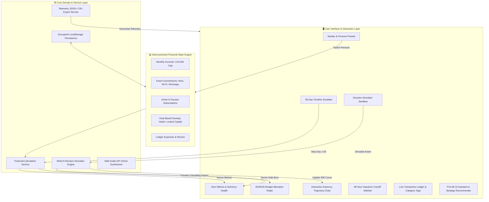

# ⚡ PULSE 30 — Gen Z Financial Command & Decision Simulator

[](https://front-end-rho-nine.vercel.app/)
[](LICENSE)
[](https://react.dev/)
[](https://vitejs.dev/)
[](https://nodejs.org/)

An enterprise-grade, interactive personal finance command center and predictive decision simulator engineered specifically for Gen Z students and young professionals managing a **₹10,000 monthly budget over 30 days**.

---

## 🌐 Live Application
- **Production URL**: [https://front-end-rho-nine.vercel.app/](https://front-end-rho-nine.vercel.app/)
- **Repository**: [https://github.com/varalaxmi123-NU/front_end](https://github.com/varalaxmi123-NU/front_end)

---

## 🏗️ System Architecture & Data Flow



---

## 🧠 Core Financial Mechanics & Formulas

### 1. Dynamic Safe-To-Spend Daily Burn Rate
Unlike traditional budgeting apps that divide remaining balance naively by days, **PULSE 30** guarantees solvency by walling off unpaid fixed obligations:

$$\text{Safe Daily Allowance} = \frac{\text{Liquid Cash Balance} - \sum \text{Upcoming Unpaid Commitments}}{\text{Total Remaining Days}}$$

### 2. Multi-Pillar Financial Health Score (0 - 100)
Calculated continuously across four weighted pillars of resilience:
1. **Solvency Runway (35%)**: Ratio of safe daily allowance to minimum baseline burn.
2. **Commitment Protection (25%)**: Ratio of liquid funds to total unpaid mandatory obligations.
3. **Savings Rate (20%)**: Percentage of monthly budget securely locked in designated savings vaults.
4. **Discretionary Discipline (20%)**: Variance between actual discretionary spend velocity vs allowable budget.

### 3. What-If Decision Simulation Sandbox
Simulate financial maneuvers in real-time before executing real-world UPI transactions:
- **Impulse Spends**: Instant projection of how a ₹1,800 hoodie or ₹850 dinner affects day 30 cash.
- **Subscription Pausing**: Freeze Spotify or Netflix to immediately reclaim ₹8 - ₹25/day safe burn allowance.
- **Side Gig Inflows**: Inject freelance revenue to offset emergency deficits.
- **Emergency Vault Transfers**: Transfer liquidity into or out of emergency shields.

---

## 📁 Repository Directory Structure

```
├── .github/                     # CI/CD Workflows
├── public/                      # Static Assets & Favicons
├── src/
│   ├── __tests__/               # Unit Test Suites (Node Native Test Runner)
│   │   └── financeEngine.test.js
│   ├── assets/                  # SVG Icons & Graphic Assets
│   ├── components/              # Modular React UI Components
│   │   ├── AddExpenseModal.jsx
│   │   ├── CommitmentsAndSubs.jsx
│   │   ├── DecisionSimulator.jsx
│   │   ├── ErrorBoundary.jsx
│   │   ├── FinancialHealthWidget.jsx
│   │   ├── HeroMetrics.jsx
│   │   ├── InnovationSuite.jsx
│   │   ├── Navbar.jsx
│   │   ├── PulseCopilot.jsx
│   │   ├── SavingsVaults.jsx
│   │   ├── SimulationBanner.jsx
│   │   ├── TimelineScrubber.jsx
│   │   ├── TrajectoryChart.jsx
│   │   ├── TransactionLedger.jsx
│   │   └── UnexpectedShockRoulette.jsx
│   ├── constants/               # Configs & Design System Tokens
│   │   ├── financeConstants.js
│   │   └── themeConstants.js
│   ├── context/                 # Centralized React State Context
│   │   └── FinanceContext.jsx
│   ├── data/                    # Initial States & Persona Presets
│   │   └── initialData.js
│   ├── hooks/                   # Custom Reusable React Hooks
│   │   ├── useFinancialEngine.js
│   │   ├── useLocalStorage.js
│   │   └── useSound.js
│   ├── services/                # Domain & Infrastructure Services
│   │   ├── exportService.js
│   │   ├── financialCalculationService.js
│   │   └── storageService.js
│   ├── utils/                   # Pure Engine Utilities & Synthesizers
│   │   ├── audioEffects.js
│   │   ├── financeEngine.js
│   │   └── performance.js
│   ├── App.css                  # Fully Responsive Design & WCAG Accessibility
│   ├── App.jsx                  # Root Application Component
│   ├── index.css                # Global CSS Design Tokens & Reset
│   └── main.jsx                 # React Entry Point with Error Boundary
├── index.html                   # Semantic HTML5, SEO Metadata & Font Preconnects
├── package.json                 # Project Dependencies & Automated Scripts
├── vercel.json                  # Production Edge Routing Config
└── vite.config.js               # Optimized Production Bundler & Manual Chunk Splitting
```

---

## ⚡ Getting Started & Local Development

### Prerequisites
- Node.js (v18.0.0 or higher, v20+ recommended)
- npm (v9.0.0 or higher)

### Installation
```bash
# Clone repository
git clone https://github.com/varalaxmi123-NU/front_end.git

# Navigate into project directory
cd front_end

# Install production and development dependencies
npm install
```

### Running Local Development Server
```bash
npm run dev
```
Open your browser at `http://localhost:5173`.

### Running Unit Test Suite
```bash
npm test
```
Executes the native test runner covering calculations, decision simulator cascading logic, and trajectory models.

### Linting & Code Quality Audit
```bash
npm run lint
```
Runs `oxlint` ensuring 0 warnings and 0 errors across all source files.

### Production Build
```bash
npm run build
```
Generates production-optimized assets inside the `dist/` directory with code splitting.

---

## ♿ Accessibility & Performance Verification

- **WCAG 2.1 AA Compliant**: High contrast dark mode (`#070A12`), semantic headings (`<h1>` hierarchy), keyboard tab order, skip navigation link (`.skip-link`), and complete ARIA attributes (`aria-label`, `aria-hidden`, `aria-modal`, `role="region"`).
- **Zero Heavy Audio Assets**: Synthesizes UI clicks and chimes on the fly via the Web Audio API without network roundtrips.
- **Client-Side Privacy**: 100% offline-ready client execution with zero telemetry trackers or data collection.

---

## 📄 License
This project is licensed under the MIT License — see the [LICENSE](LICENSE) file for details.
